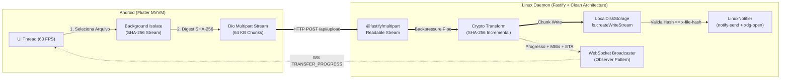
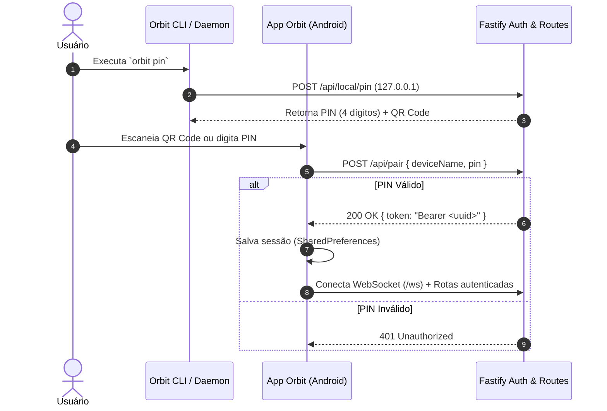
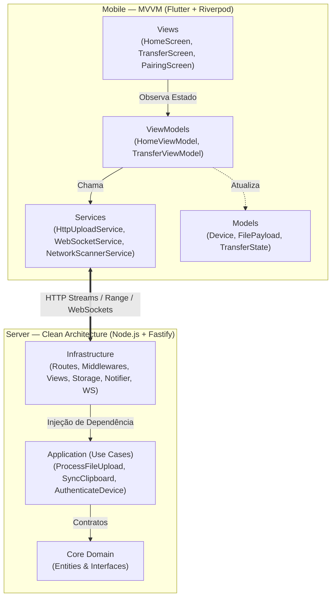

# Orbit

> **Transferência direta de arquivos e sincronização bidirecional de área de transferência entre Android e Linux via rede Wi-Fi local — sem nuvem, sem cabos e com uso constante de memória $O(1)$.**


---

## Destaques de Engenharia

- **Streaming Zero-Memory ($O(1)$ RAM):** Uploads e downloads via pipeline de HTTP Streams com controle de *backpressure* direto para o disco, mantendo a variação de memória em **~1.39 MB** mesmo em arquivos de múltiplos gigabytes.
- **Integridade SHA-256 e Multithreading:** Cálculo do hash em Isolate separado no Flutter (sem travar a UI) e validação concorrente no servidor durante a gravação do stream.
- **Telemetria Duplex em Tempo Real:** Progresso em tempo real (`MB/s` e `ETA`) via WebSockets e suporte a cancelamento com limpeza automática de arquivos incompletos.
- **Segurança Zero-Trust na LAN:** Pareamento via QR Code ou PIN de 4 dígitos, autenticação por *Bearer Token* e proteção contra *Path Traversal* e *Command Injection*.
- **Smart Clipboard Bidirecional:** Classificação automática do texto (URL, JSON, Markdown ou código) com integração nativa ao Wayland (`wl-copy`) e X11 (`xclip`).
- **Integração Nativa Linux e Android:** Daemon `systemd`, CLI dedicada (`orbit`), notificações interativas com abertura de pasta (`xdg-open`), painel web local e suporte ao menu "Compartilhar com..." do Android.

---

## Arquitetura e Fluxos

### 1. Pipeline de Streaming Sem Bufferização

Os bytes recebidos não são acumulados na RAM. O stream HTTP passa por um transformador que calcula o SHA-256 incrementalmente e publica o progresso via WebSocket enquanto grava direto no disco:



---

### 2. Handshake Zero-Trust (PIN + Bearer Token)



---

### 3. Organização em Camadas (Clean Architecture + MVVM)



---

## Benchmark de Performance (Arquivo de 1 GB)

Resultado real obtido com [`server/scripts/benchmark-1gb.ts`](server/scripts/benchmark-1gb.ts) (`npm run benchmark --prefix server`):

| Métrica | Resultado Obtido | Meta |
| :--- | :--- | :--- |
| **Volume Transferido** | `1.00 GB` (`1,073,741,824 bytes`) | `1.00 GB` |
| **Tempo Total** | `2.13 segundos` | `< 10.0 s` |
| **Velocidade Média** | **`481.4 MB/s`** | `> 100 MB/s` |
| **Memória Heap Inicial** | `19.26 MB` | — |
| **Pico de Memória Heap** | `20.66 MB` | `< 100 MB` |
| **Variação de Memória ($\Delta$ Heap)** | **`+1.39 MB`** | **`< 50.0 MB`** |
| **Integridade SHA-256** | `100% Verificado (201 Created)` | `Sem colisão` |

---

## Estrutura do Projeto

```text
orbit/
├── bin/
│   └── orbit                           # Executável da CLI Linux
├── server/                             # Backend Linux (Clean Architecture)
│   ├── scripts/
│   │   └── benchmark-1gb.ts            # Benchmark automatizado de 1 GB
│   └── src/
│       ├── core/                       # Entidades e Interfaces de Domínio
│       ├── application/                # Casos de Uso (Upload, Clipboard, Auth)
│       ├── infrastructure/
│       │   ├── http/
│       │   │   ├── middlewares/        # authMiddleware (Bearer Token e Loopback)
│       │   │   ├── routes/             # Rotas separadas por domínio
│       │   │   ├── utils/              # Padronização de erros HTTP
│       │   │   └── views/              # Template HTML do Web Dashboard
│       │   ├── security/               # PinPairingManager e NodeCryptoService
│       │   ├── storage/                # LocalDiskStorage (Streams + Path Sanitization)
│       │   ├── system/                 # Clipboard, Notifier e mDNS
│       │   └── websocket/              # Servidor WebSocket e MessageFactory
│       ├── cli.ts                      # Comandos da CLI
│       └── main.ts                     # Ponto de entrada do servidor
├── mobile/                             # App Android (Flutter MVVM + Riverpod)
│   └── lib/
│       ├── models/                     # Entidades imutáveis
│       ├── services/                   # HTTP/Streams, Isolate SHA-256, WebSocket, Radar LAN
│       ├── utils/                      # IpParser e utilitários
│       ├── viewmodels/                 # Gerenciamento de estado (StateNotifier)
│       ├── views/                      # Telas da aplicação
│       └── widgets/                    # Componentes visuais reutilizáveis
└── systemd/
    └── orbit.service                   # Serviço systemd do usuário
```

---

## Uso no Linux (Produção)

### 1. CLI (`orbit`)

```bash
orbit status    # Status do servidor, IP local, conexões e uso de RAM
orbit pin       # Exibe o PIN atual e gera o QR Code no terminal
orbit logs      # Exibe os logs do serviço em tempo real
orbit restart   # Reinicia o daemon em background
```

### 2. Web Dashboard (PC para Celular)

Acesse `http://localhost:3000` no navegador para enviar arquivos do computador para o celular via Drag & Drop ou sincronizar textos para a área de transferência do Android.

### 3. Serviço Systemd

```bash
systemctl --user status orbit.service
systemctl --user restart orbit.service
```

---

## Desenvolvimento e Testes

### Servidor (Node.js / TypeScript)

```bash
cd server
npm install
npm test          # Executa os 12 testes de integração
npm run build     # Compila TypeScript para dist/
npm run benchmark # Executa o teste de estresse de 1 GB
```

### Mobile (Flutter)

```bash
cd mobile
flutter pub get
flutter analyze   # Análise estática
flutter test      # Testes unitários
flutter run --release
```
